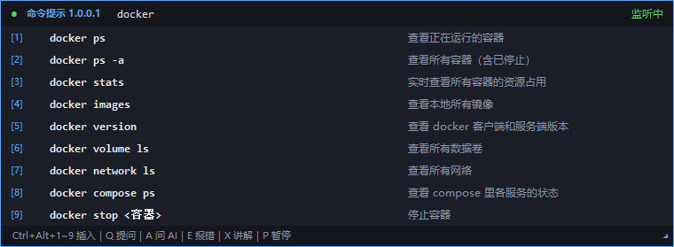

# 命令提示（CmdHint）

Windows 上的本地命令提示条：在任意窗口里敲字时，实时给出你可能想用的运维命令。想不起命令时，可以直接用中文问 AI。

> A local desktop tool for Windows that suggests shell commands as you type — in any terminal, SSH client, or browser-based bastion host. Chinese-first UI, Windows only.



## 为什么做这个

运维经常记不住命令，尤其是半年才用一次的那种。这个工具常驻托盘，在终端、PuTTY、Xshell、网页堡垒机里敲字时，提示条会实时列出可能想用的命令，按快捷键就能打进当前那一行。

## 功能

- **实时提示**：任意窗口里敲 1 个字符就开始提示，最多 9 条，不抢焦点、不挡终端。
- **英文和拼音**：敲 `docker`、`neicun`、`cipan` 都能匹配。拼音支持全拼和首字母缩写。
- **2500+ 条运维命令**：覆盖 Linux 文件、磁盘、网络、日志、Docker、K8s、数据库、中间件、Git、Windows 等 23 类。
- **AI 提问**（`Ctrl+Alt+Q`）：提示条变成输入框，用中文描述需求，最多给 5 条命令并标出最贴合的一条；问概念时直接给中文回答。
- **命令讲解**（`Ctrl+Alt+X`）：逐个参数解释一条命令，并指出风险。
- **报错分析**（`Ctrl+Alt+E`）：读剪贴板里的报错，给出最可能的原因和修复命令。
- **参数填空**：插入带 `<容器>`、`<端口>` 这类占位的命令前，可以先把值填好。
- **危险命令二次确认**：删除、格式化、清库这类命令要连按两次才会插入。
- **可调窗口**：拖动提示条可移动，拖右下角的 `◢` 可调宽度和行数，位置会记住。
- **自己加命令**：编辑 `%APPDATA%\CmdHint\commands_user.txt`，保存后几秒内生效，不用重新打包。
- **自动更新**：启动后自动检查 GitHub 上的新版本，在后台下载并校验；托盘菜单点「重启并更新」即可升级。默认不会自己重启。

## 快捷键

所有快捷键都是 Ctrl+Alt 加一个键，在任何窗口里都能用：

| 快捷键 | 作用 |
|---|---|
| `1`~`9` | 把提示条里第 N 条命令打进当前行 |
| `Q` | 提问模式：提示条变成输入框，可以打中文。Enter 发送，Esc 取消 |
| `A` | 把当前终端里已经敲的内容发给 AI |
| `X` | 讲解一条命令。先按 `X` 再按 `1`~`9` 选；没有待选项时讲解已敲出的那行 |
| `E` | 分析剪贴板里的报错 |
| `P` | 暂停或恢复 |

托盘图标右键：暂停、开机自启、打开配置文件、退出。

## 下载与运行

**直接下载**：[Releases](https://github.com/dsgsg3/cmd-hint/releases) 里有打包好的 exe（文件名带版本号），双击就能用，不需要装 Python。程序没有代码签名，首次运行 Windows 可能提示「未知发布者」，点「更多信息 → 仍要运行」。

另外两种方式：

- **自己打包**：装好 Python 3.12 和依赖，双击 `一键打包.cmd`，产物在 `dist\命令提示.exe`。
- **直接跑源码**：在 `cmdhint` 目录运行 `python main.py`。

依赖：

```
pip install keyboard pystray pillow pypinyin pyinstaller
```

只支持 Windows 10/11，因为用到了全局键盘钩子和 Win32 接口。

## 配置

首次运行会在 `%APPDATA%\CmdHint\config.json` 生成默认配置。常用的几项：

- `api_base_url` / `api_key` / `api_model`：任意 OpenAI 兼容接口的地址、密钥、模型名。三项齐全才用云端 AI，否则回退到本机 `kimi -p` 命令。
- `update_mode`：`"download"`（默认，下载并提示你点菜单重启）｜`"auto"`（下载后自动重启）｜`"off"`（不检查更新）。
- `update_proxy`：更新时走的代理，留空则用系统代理（Windows 设置里的那个）。
- `scope`：默认 `"all"`，所有窗口都提示；改成 `"terminals"` 就只认 `terminals` 列表里的程序。
- `exclude`：不记录按键的程序名，默认排除密码管理器。
- `min_chars` / `max_items` / `ai_timeout`：开始提示的字符数、最多几条、AI 超时秒数。

密钥只存在这个文件里，不在仓库里，也不要提交上来。

## 自己加命令（不用重新打包）

**自己用**：右键托盘图标，选「打开命令文件」，编辑 `%APPDATA%\CmdHint\commands_user.txt`。保存后几秒内自动生效，不用重启，也不用重新打包。同一条命令以你的文件为准，会覆盖内置的那条。

**想贡献给所有人**：改仓库里的 `cmdhint/commands_extra.txt` 提 PR，下个版本会带上。

两种文件格式一样，一行一条：

```
分类¦命令¦说明¦标签1,标签2¦标志
```

- 分类用 `file` `disk` `net` `log` `docker` `k8s` `git` `db` `mid` `win` 这些。新分类先加一行 `@cat¦id¦名称`。
- 命令里需要替换的部分用 `{{参数}}`，例如 `docker restart {{容器}}`。
- 标签用于搜索，中英文都行。`d` 表示危险命令（插入前要确认），`h` 表示常用（排序靠前）。
- 命令重复会自动跳过；在你自己的文件里则覆盖内置的同名命令。格式不对的行会被忽略。

例子：

```
net¦ss -lntp¦查看所有监听端口及对应进程¦端口,监听¦h
net¦iptables -F¦清空所有防火墙规则（可能导致断连）¦防火墙,清空¦d
@cat¦redis¦Redis
redis¦redis-cli --bigkeys¦找出最大的 key¦redis,大key¦h
```

## 隐私

这个工具要监听键盘，边界写清楚：

- 只记录按键，不记录鼠标和屏幕，也不读取终端里的内容。
- 缓冲只在内存里，不写磁盘。切换窗口、按 Enter、方向键都会清空它。
- 只有你按 `Ctrl+Alt+Q`（提问）、`Ctrl+Alt+A`（问 AI）、`Ctrl+Alt+E`（报错分析）、`Ctrl+Alt+X`（讲解）时，内容才会发给 AI，不会自动发送。
- `Ctrl+Alt+P` 随时暂停，托盘菜单可以退出。
- 默认排除密码管理器。在 sudo、SSH 的密码提示处输入的内容也会进缓冲，输密码前建议先暂停。

## 已知限制

- 看不到终端里真实的那一行。用过方向键、Tab 补全、粘贴之后，提示条里的内容会和终端对不上。
- 管理员权限的窗口，要用管理员身份运行本程序才收得到按键。
- 中文输入法只测过微软拼音，搜狗等没验证。
- 杀毒软件可能把全局键盘钩子当成键盘记录器，需要加白名单。
- 自动更新需要程序所在目录可写。放在 Program Files 这类需要管理员权限的位置时，更新会失败并提示手动下载。

## 项目结构

| 路径 | 说明 |
|---|---|
| `cmdhint/` | 主程序（Python + tkinter） |
| `cmdhint/commands_extra.txt` | 命令库，欢迎提交 PR 扩充 |
| `cmdhint/build.py`、`一键打包.cmd` | 一键打包 |
| `docs/` | 截图 |
| `index.html` `app.js` `data.js` `app.py` | 同目录下的另一个程序：网页版命令手册「运维命令速查」 |

开发细节（架构、线程模型、打包、踩过的坑）在 [AGENTS.md](AGENTS.md)。

## 参与贡献

欢迎补充命令、修 bug、加功能，看 [CONTRIBUTING.md](CONTRIBUTING.md)。

## 许可证

[MIT](LICENSE)